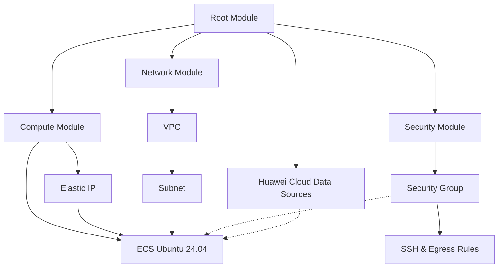

# Lab 06 — Terraform Modules & Reusable Infrastructure on Huawei Cloud

## 1. Overview

This lab demonstrates how to organize Huawei Cloud infrastructure using reusable Terraform modules.

Instead of defining all cloud resources in a single Terraform configuration, this project separates infrastructure into three modules: Network, Security, and Compute.

**Objectives:**
- Understand Terraform Root Modules and Child Modules.
- Build reusable infrastructure components.
- Connect modules using input variables and outputs.
- Use Terraform Data Sources to retrieve cloud resource information.
- Validate infrastructure configurations using `terraform init`, `terraform validate`, and `terraform plan`.

**Cloud Environment:**

| Component | Configuration |
|---|---|
| Cloud Provider | Huawei Cloud |
| Region | AP-Jakarta (`ap-southeast-4`) |
| Infrastructure as Code | Terraform |
| Provider Version | Huawei Cloud Provider v1.100.0 |
| Operating System | Ubuntu 24.04 |
| ECS Flavor | `s7n.small.1` |
| Authentication | Password |
| Billing Mode | Pay-per-use (`postPaid`) |

**Project Status:** Configuration completed and validated. Infrastructure deployment has not been executed.
## 2. Architecture

This project uses a modular Terraform architecture to provision Huawei Cloud infrastructure.

The Root Module coordinates three Child Modules: Network, Security, and Compute.

### Architecture Diagram



### Module Responsibilities

| Module | Responsibilities |
|---|---|
| Root Module | Coordinates child modules, provider configuration, data sources, and outputs |
| Network Module | Creates the VPC and subnet |
| Security Module | Creates the security group and inbound/outbound rules |
| Compute Module | Defines the ECS instance, EIP, and EIP association |

### Module Dependencies

The Compute Module receives networking and security information through outputs from other modules.

```hcl
subnet_id         = module.network.subnet_ipv4_id
security_group_id = module.security.security_group_id
```

Terraform automatically determines the resource creation order based on these references.

## 3. Project Structure

```text
06-Terraform-Modules/
├── main.tf
├── data.tf
├── variables.tf
├── outputs.tf
├── versions.tf
├── .terraform.lock.hcl
├── .gitignore
├── README.md
└── modules/
    ├── network/
    │   ├── main.tf
    │   ├── variables.tf
    │   ├── outputs.tf
    │   └── versions.tf
    ├── security/
    │   ├── main.tf
    │   ├── variables.tf
    │   ├── outputs.tf
    │   └── versions.tf
    └── compute/
        ├── main.tf
        ├── variables.tf
        ├── outputs.tf
        └── versions.tf
```

The `.terraform/` working directory and Terraform state files are excluded from version control using `.gitignore`.
## 4. Infrastructure Configuration

The following infrastructure is defined using reusable Terraform modules.

| Resource | Configuration |
|---|---|
| VPC | `terraform-module-vpc` |
| VPC CIDR | `192.168.0.0/16` |
| Subnet | `terraform-module-subnet` |
| Subnet CIDR | `192.168.1.0/24` |
| Subnet Gateway | `192.168.1.1` |
| Security Group | `terraform-module-sg` |
| Inbound Rule | TCP port 22, restricted to a single trusted IP (`/32`) |
| Outbound Rule | IPv4 outbound traffic allowed |
| ECS Name | `terraform-module-ecs` |
| ECS Flavor | `s7n.small.1` |
| Operating System | Ubuntu 24.04 |
| System Disk | GPSSD, 40 GiB |
| Authentication | Administrator password |
| Charging Mode | Pay-per-use (`postPaid`) |
| Elastic IP | Dynamic public IPv4 address |
| EIP Bandwidth | 1 Mbit/s, traffic-based billing |

## 5. Terraform Workflow

### Step 1 — Initialize Terraform

```powershell
terraform init
```

Initializes the Terraform working directory, downloads required providers, and initializes child modules.

### Step 2 — Format Configuration

```powershell
terraform fmt -recursive
```

Formats Terraform configuration files consistently across the root and child modules.

### Step 3 — Validate Configuration

```powershell
terraform validate
```

Checks Terraform configuration syntax, references, and provider schema compatibility.

### Step 4 — Configure ECS Password

The ECS administrator password is provided through a Terraform environment variable instead of being hardcoded in the configuration.

```powershell
$SecurePassword = Read-Host "Enter ECS password" -AsSecureString
$env:TF_VAR_ecs_password = [System.Net.NetworkCredential]::new("", $SecurePassword).Password
```

**Security Note:** Sensitive Terraform variables can still be stored in Terraform state. State files must be protected and excluded from version control.

### Step 5 — Preview Infrastructure Changes

```powershell
terraform plan
```

Generates an execution plan showing the infrastructure changes Terraform would perform.

**Validation Result:**

```text
Success! The configuration is valid.

Plan: 8 to add, 0 to change, 0 to destroy.
```

### Deployment Status

This lab has completed Terraform initialization, validation, and planning.

Infrastructure deployment has not been executed. The configuration represents a planned deployment, not provisioned cloud resources.

Before any future deployment, verify cloud resource availability, credentials, the trusted SSH source IP, and applicable Huawei Cloud charges.

## 6. Security Best Practices

This project follows basic Infrastructure as Code security practices.

- **Credential Management:** Huawei Cloud credentials are supplied through environment variables instead of being hardcoded in Terraform configuration files.
- **Sensitive Variables:** The ECS administrator password is declared with `sensitive = true` and provided through `TF_VAR_ecs_password`.
- **Network Security:** Inbound SSH access (TCP port 22) is restricted to a trusted public IP address using a `/32` CIDR.
- **State Protection:** Terraform state files are excluded from Git because they may contain sensitive information, including administrator passwords.
- **Version Control:** The `.terraform/` directory, Terraform state, variable files, and local environment files are excluded using `.gitignore`.
- **Provider Versioning:** The `.terraform.lock.hcl` file is retained to support reproducible provider installation.

**Important:** Marking a Terraform variable as sensitive hides its value from normal CLI output but does not encrypt or remove it from Terraform state.

For production environments, additional security measures such as centralized secret management, encrypted remote state, least-privilege IAM policies, and stronger SSH authentication should be considered.

## 7. Infrastructure Cleanup

After deploying the infrastructure for testing, Terraform can be used to remove the managed resources.

### Preview Resource Destruction

```powershell
terraform plan -destroy
```

This command previews which managed resources Terraform would remove.

### Destroy Infrastructure

```powershell
terraform destroy
```

Terraform displays a destruction plan and requests confirmation before deleting the managed resources.

**Warning:** Running `terraform destroy` can permanently delete infrastructure and associated data. Review the destruction plan carefully before confirming.

### Project Status

This project has been validated using `terraform init`, `terraform validate`, and `terraform plan`.

The latest successful plan showed:

```text
Plan: 8 to add, 0 to change, 0 to destroy.
```

No infrastructure has been deployed as part of this lab.